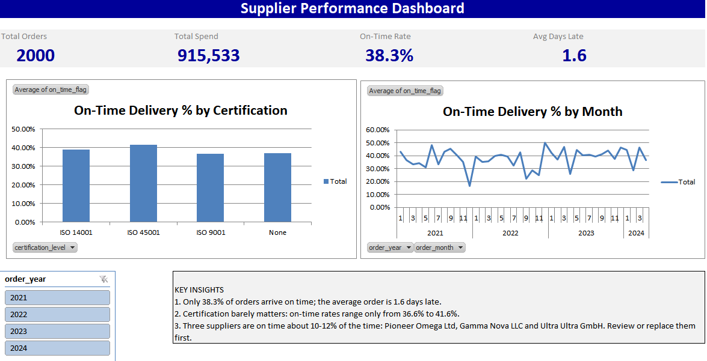

# Supplier Performance Dashboard (Excel)

## Business question
Which suppliers are reliable, which deliver late, and where is the money going?

## Data
2,000 purchase orders from 100 suppliers (2021-2024). Source: Kaggle "Supply Chain Datasets".

## What I did
- Checked data quality (no blanks or duplicates, totals verified)
- Combined orders with supplier details using VLOOKUP
- Calculated days late and an on-time flag for each order
- Built PivotTables, charts and a year slicer on a one-page dashboard

## Key findings
- Only 38.3% of orders arrive on time (average 1.6 days late)
- Certification barely affects reliability (36.6% to 41.6%)
- Three suppliers are on time only 10-12% of the time

## Tools
Excel 2010: PivotTables, slicers, VLOOKUP, IF, charts

## Files
- `Supplier_Performance_Dashboard.xlsx`: full workbook
- `dashboard_cover.png`, `dashboard_full.png`: screenshots
